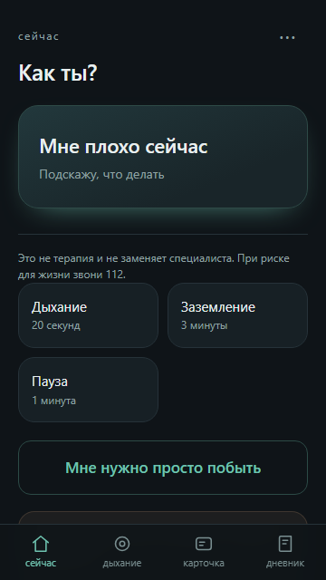
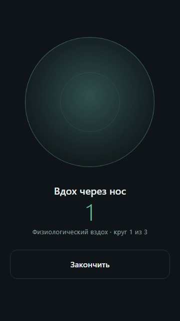

# Опора

PWA на телефон для трудных минут: техники, чтобы пережить накат, и свои слова на случай, когда думать уже не получается.

**Важно.** Это не терапия и не замена помощи специалисту. Если есть риск для жизни — твой или чужой — звони **112**.

**Открыть: https://testsoulja.github.io/prl-helper/**

Снято с 0.7.3 на телефон 360×640.

| Главная | Контакты | Дыхание |
|:---:|:---:|:---:|
|  |  |  |

## Что внутри

**Когда накрывает.** 11 техник: четыре дыхания (физиологический вздох, 4–7–8, квадратное, медленное), заземление 5–4–3–2–1, СТОП, «десять минут», «напрягись и отпусти», письмо, которое не отправится, тело против эмоции, просто пауза. Плюс развилка по состоянию (тревога, злость, пустота, импульс, из-за человека, «не знаю») и режим «мне нужно просто побыть» с таймером на пять минут.

**Сразу.** Кризис-карточка: пять полей о себе, заполненных заранее — что помогает, что делает хуже, кому звонить, план на первые десять минут, зачем остаюсь. Контакты в один тап на звонок: 112, горячая линия МЧС (психолог, круглосуточно), «детям и родителям» и свои номера.

**Потом.** Дневник: настроение, темы, заметка и полоска настроения по последним 14 записям; по темам видно, что тогда помогало. Три готовых сообщения близким — копируются в буфер, приложение ничего не отправляет. Копия данных файлом и восстановление из файла.

## На чём это основано

Тексты, кризисный блок и границы обещаний сверены с открытой базой
[«Пси-база»](https://testsoulja.github.io/psybase/ru/prl/): там у каждого числа
назван источник и тип исследования, а в конце темы — что искали и не нашли.

Приложение не обещает лечить. В базе нет данных, что цифровая программа
снижает тяжесть расстройства, а формат «одна техника в трудную минуту»
в исследованиях не проверялся — проверяли программы на недели и месяцы.
Поэтому здесь нет ни обещания эффекта, ни шкал, ни «проверь себя»: только то,
что можно попробовать, и свои слова на случай, когда думать трудно.

Ссылки на базу в самом приложении нет: в нём ни одного внешнего адреса,
и это проверяется тестом.

## Установка

**iPhone**

1. Открыть https://testsoulja.github.io/prl-helper/ в Safari.
2. «Поделиться» → «На экран Домой».

**Android**

1. Открыть тот же адрес в Chrome.
2. Меню ⋮ → «Установить приложение» (или «Добавить на главный экран»).

После установки приложение открывается без сети.

## Твои данные

Всё лежит на телефоне: в `localStorage` и второй копией в IndexedDB. Нет ни сервера, ни аккаунта, ни синхронизации, ни аналитики — ни одного внешнего запроса, и это проверяется тестом.

Копия файлом **не зашифрована**: кто откроет файл, прочитает записи. Об этом сказано и на экране копии. Пересылка или скачивание — осознанный шаг: файл покидает телефон.

## Чего здесь нет

Ни сервера, ни аккаунта, ни синхронизации, ни аналитики, ни трекеров, ни серий и очков, ни напоминаний, ни ИИ-чата.

## Версия

Версия 0.7.3 · 25.11.2026

- 0.7.3 — крупный системный шрифт (200 %) больше не уезжает вбок: ряд настроения переносится, заголовки и подписи вкладок остаются в экране.
- 0.7.2 — тап открывает экран сверху, а системный «назад» возвращает туда, где человек был.
- 0.7.1 — цели нажатия не меньше 44 px.

## Ошибки

Если что-то не работает — [Issue в публичном репозитории](https://github.com/TestSoulja/prl-helper/issues). Для Issue нужен аккаунт GitHub; без него страница предложит войти. Там нет ни переписки, ни данных из приложения: видно только то, что написано в самом Issue.

*Это не терапия. Если есть риск для жизни — 112.*
