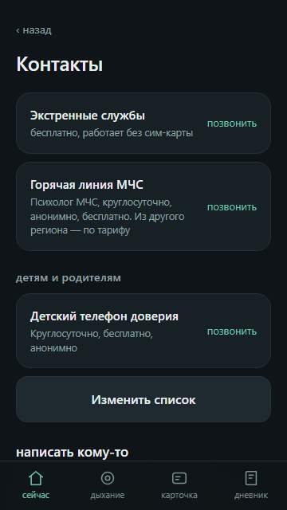

# Опора

PWA на телефон для трудных минут: техники, чтобы пережить накат, и свои слова на случай, когда думать уже не получается.

**Важно.** Это не терапия и не замена помощи специалисту. Если есть риск для жизни — твой или чужой — звони **112**.

**Открыть: https://testsoulja.github.io/prl-helper/**

Снято на экране 360×640 (эмуляция Chromium).

| Главная | Контакты | Дыхание |
|:---:|:---:|:---:|
|  |  |  |

## Что внутри

**Когда накрывает.** 13 техник: четыре дыхания (физиологический вздох, 4–7–8, квадратное, медленное), заземление 5–4–3–2–1, СТОП, «десять минут», «напрягись и отпусти», письмо, которое не отправится, тело против эмоции, просто пауза, «одно маленькое дело» — назвать одно действие на минуту и сделать только его, и «первое физическое действие» — уменьшить дело до движения тела. Плюс развилка по состоянию (тревога, злость, пустота, импульс, из-за человека, «застряла, не могу начать», «не знаю») и режим «мне нужно просто побыть» с таймером на пять минут.

**Сразу.** Кризис-карточка: пять полей о себе, заполненных заранее — что помогает, что делает хуже, кому звонить, план на первые десять минут, зачем остаюсь. План можно пройти по шагам, первое имя стоит крупно, а 112 — рядом с ним всегда; есть необязательная строка «что убрать подальше». Контакты в один тап на звонок: 112, горячая линия МЧС (психолог, круглосуточно), «детям и родителям» и свои номера. Если после смены препарата или дозы стало резко хуже — это не то же самое, что паника: в карточке и в контактах написано, куда звонить (врач, который назначил препарат, или 112). Там же — «первый шаг к врачу» (что сказать и что взять) и «если звонить некому»: 112 и линия МЧС, номер словами.

**Потом.** Дневник: настроение, темы, заметка и полоска настроения по последним 14 записям; по темам видно, что тогда помогало. Если сон заполняли, под записями видно «как спалось» — просто строки за те же 14 записей, без средних и нормы. Шесть готовых сообщений близким — просьба поговорить, быть на связи, побыть одной, ответ на «соберись», просьба не советовать и просьба вернуться к разговору позже; копируются в буфер, текст можно изменить под себя, приложение ничего не отправляет. Копия данных: текст в буфер (главный путь) или файл; можно взять всё или только записи за 14 дней — второй режим для разговора с врачом. Восстановление из файла или вставленного текста.

**Каждый день.** «Что принимаю»: список препаратов своими словами — название, как принимаю, с какого дня, каждый день или по необходимости. У каждого препарата своя строка отметки: «приняла» и «не приняла»; пока ничего не нажато, на экране об этом ни слова. Сон — необязательная строка в дневнике: «спала 5 ч · спала днём». Приложение не считает дозу, не узнаёт препарат и не даёт советов по лечению: оно хранит и печатает то, что человек написал сам.

## На чём это основано

Тексты, кризисный блок и границы обещаний сверены с открытой базой
[«Пси-база»](https://testsoulja.github.io/psybase/ru/prl/): там у каждого числа
назван источник и тип исследования, а в конце темы — что искали и не нашли.

Приложение не обещает лечить. В базе нет данных, что цифровая программа
снижает тяжесть расстройства, а формат «одна техника в трудную минуту»
в исследованиях не проверялся — проверяли программы на недели и месяцы.
Поэтому здесь нет ни обещания эффекта, ни шкал, ни «проверь себя»: только то,
что можно попробовать, и свои слова на случай, когда думать трудно.

Ссылки на базу в самом приложении нет: в нём ни одного внешнего адреса,
и это проверяется тестом.

## Установка

**iPhone**

1. Открыть https://testsoulja.github.io/prl-helper/ в Safari.
2. «Поделиться» → «На экран Домой».

**Android**

1. Открыть тот же адрес в Chrome.
2. Меню ⋮ → «Установить приложение» (или «Добавить на главный экран»).

После установки приложение открывается без сети.

## Твои данные

Всё лежит на телефоне: в `localStorage` и второй копией в IndexedDB. Нет ни сервера, ни аккаунта, ни синхронизации, ни аналитики — ни одного внешнего запроса, и это проверяется тестом.

Копия файлом **не зашифрована**: кто откроет файл, прочитает записи. Об этом сказано и на экране копии. Пересылка или скачивание — осознанный шаг: файл покидает телефон.

Пути наружу два, и оба работают без системного листа «Поделиться». «Скопировать текст копии» кладёт JSON в буфер — вставить можно в любую переписку. «Скачать файл» отдаёт файл браузеру или в «Файлы» телефона: приложение не узнаёт, сохранился ли он. Системный лист «Поделиться» не используется: на телефоне он отвечал отказом, который от типа файла не зависел.

## Чего здесь нет

Ни сервера, ни аккаунта, ни синхронизации, ни аналитики, ни трекеров, ни серий и очков, ни напоминаний, ни ИИ-чата.

## Версия

Версия 0.9.0 · 27.11.2026

- 0.9.0 — копия без системного листа «Поделиться»: два пути, которые не зависят от него, — текст в буфер и файл. Новое в трудную минуту: ветка «застряла, не могу начать» уменьшает дело до первого движения тела, «одно маленькое дело», текст про пик паники, вариант «про себя» внутри «Импульса». В карточке — план шагами, первое имя крупно и 112 рядом, поле «что убрать подальше». В контактах — «первый шаг к врачу» и «если звонить некому». Близким — шесть готовых фраз. Копию можно сделать короче: только записи дневника. Новые блоки можно отключать по одному, не откатывая код.
- 0.8.6 — отказ «Поделиться» перестал быть тупиком на сессию: главной становится «Скопировать текст копии», «Отправить» остаётся вторичной с пометкой «сейчас не сработало», а успех снимает пометку. Текст отказа называет два выхода и больше не советует открывать сайт в другом браузере. Диагностика показывает движок и активацию — чтобы отличить наш дефект от отказа системы.
- 0.8.5 — номер версии и код больше не расходятся: после обновления поведение соответствует тому номеру, который видно. Первое открытие после обновления ещё может показать новый номер со старым видом — это последний такой раз, второе открытие чистое. Заодно приложение открывается из кэша, не дожидаясь сети.
- 0.8.4 — у сбоя «Отправить» появился выход, а обещание про иконку на главном экране убрано: оно не было проверено.
- 0.8.3 — «Отправить» честно отвечает на отказ встроенного окна: называет выход и не делает вид, что файл вот-вот уйдёт.
- 0.8.2 — уборка разметки внутри: отметка и список препаратов собираются из одного шаблона. На экранах ничего не изменилось.
- 0.8.1 — отметка по каждому препарату отдельно, «Вернуть» переживает слияние копий, предупреждение о копии перечисляет, что внутри.
- 0.8.0 — «Что принимаю» и отметка приёма, сон в дневнике. Доза — только текстом; «нет отметки» — это отсутствие записи, а не упрёк.
- 0.7.4 — после смены препарата или дозы: если стало резко хуже, карточка и контакты говорят, куда звонить (врач или 112). Без советов по дозам — это решение не приложения.
- 0.7.3 — крупный системный шрифт (200 %) больше не уезжает вбок: ряд настроения переносится, заголовки и подписи вкладок остаются в экране.
- 0.7.2 — тап открывает экран сверху, а системный «назад» возвращает туда, где человек был.
- 0.7.1 — цели нажатия не меньше 44 px.

## Ошибки

Если что-то не работает — [Issue в публичном репозитории](https://github.com/TestSoulja/prl-helper/issues). Для Issue нужен аккаунт GitHub; без него страница предложит войти. Там нет ни переписки, ни данных из приложения: видно только то, что написано в самом Issue.

*Это не терапия. Если есть риск для жизни — 112.*
